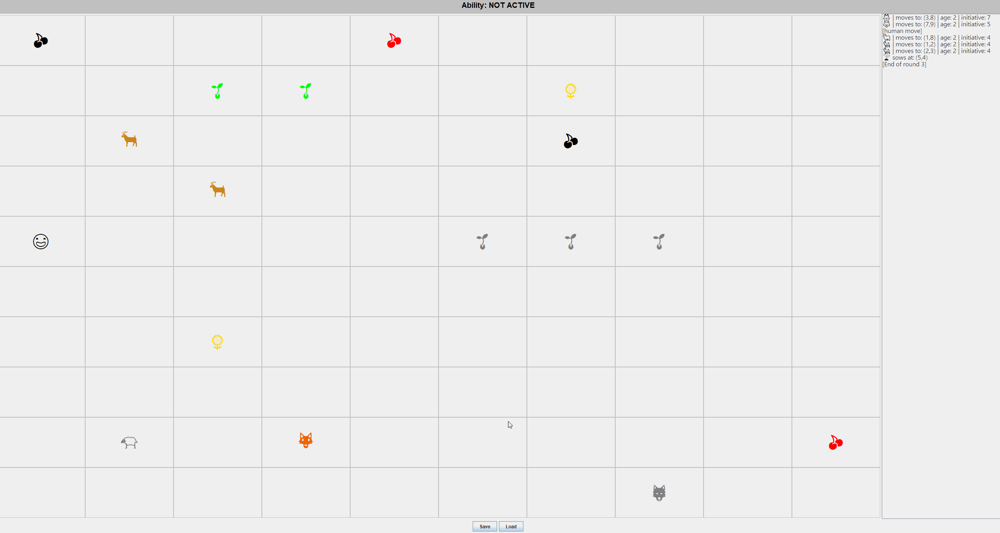

# Animal World – Java 🐺

A turn-based ecosystem simulation developed in Java using Swing. Different animal and plant species interact in a two-dimensional world, following individual rules for movement, reproduction, and survival.

Originally developed as a university Object-Oriented Programming project.



## Features

- **Turn-based simulation:** Organisms move, interact, reproduce, and compete for survival.
- **Species-specific behavior:** Different animals and plants implement unique movement, collision, and interaction rules.
- **Human-controlled character:** Control a human organism with a special ability.
- **Graphical interface:** A grid-based world with organism icons and an event log.
- **Save & Load:** Save the simulation state and restore it later.

## Technologies

- Java
- Swing / AWT
- Object-Oriented Programming

## Build & Run

**Requirements:** Java Development Kit (JDK).

Clone the repository:

```bash
git clone https://github.com/Grodek17/Animal-World-Java.git
cd Animal-World-Java
```

Compile the project:

```bash
javac -d out src/*.java
```

Run the application:

```bash
java -cp out Main
```

Run these commands from the project's root directory.

## OOP Architecture

The simulation is built around a hierarchy of classes:

- `Organism` – abstract base class defining shared properties and behaviors.
- `Animal` and `Plant` – abstract classes implementing general rules for their respective organism types.
- Concrete species (e.g. `Wolf`, `Antelope`, `Guarana`) – extend the hierarchy and override methods to implement species-specific behaviors.
- `World` – manages the simulation, organisms, and interactions.
- `GraphicLayer` – handles the Swing interface and visualization.
- `SaveLoad` – manages saving and restoring the world state.

The project demonstrates **inheritance, polymorphism, abstraction, and encapsulation** through interactions between different organism types.

## Project Background

The project was developed during university OOP coursework, using AI assistance for parts of the graphical interface and debugging.

The main learning focus was implementing and understanding the object-oriented simulation logic, particularly inheritance, polymorphism, and interactions between objects.